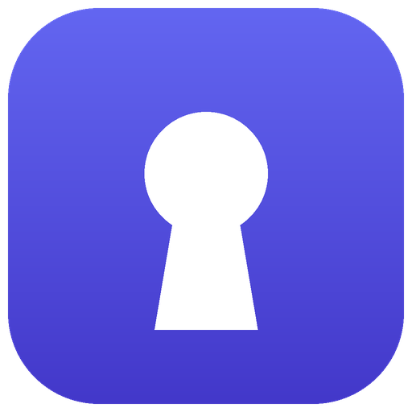

# Multiwarden

**Use several Bitwarden accounts at the same time in your browser.**

Multiwarden is an unofficial fork of the open-source Bitwarden browser extension. The official
extension lets you sign in to several accounts but only uses the _active_ one. If you run two
copies of the extension side by side, they fight over autofill, the save-password prompt and
passkeys. Multiwarden is one extension that keeps every unlocked account in play:

- **Autofill / inline menu:** suggestions from all unlocked accounts, each labelled with its
  account's email.
- **Save password prompt:** an account selector chooses where a new login goes. It defaults to
  the account you last used for that site. Logins that already exist in _any_ account are
  recognised, so you don't get a "save" prompt for something you have in your work vault.
  Password updates go to the account that owns the login.
- **Passkeys:** sign-in finds passkeys in every unlocked account. When you create a new passkey,
  you pick the account to save it in.
- **Keyboard shortcut:** falls back to your other accounts when the active one has no login for
  the site.
- **Combined view:** pick "Combined" in the account dropdown (top right) and the normal vault
  shows every unlocked account's items together, each marked with its account's avatar. Search,
  fill, copy, edit and delete work as usual; new items ask which vault they go into.
- **Settings → Multiwarden:** combined view, remembering the save account per site, and hiding
  Premium upgrade notices.

Sign in to each account through the normal account switcher (up to five), unlock them, and
Multiwarden uses all of them.

## Install

Grab `multiwarden-chrome-*.zip` from [Releases](https://github.com/mteij/multiwarden/releases),
unzip it, open `vivaldi://extensions` (or `chrome://extensions`), turn on **Developer mode**, and
choose **Load unpacked**. Remove or disable the official Bitwarden extension first so the two
don't both try to fill.

## Maintainers

See [multiwarden/README.md](../multiwarden/README.md) for how the fork is structured, how it follows upstream,
and how to build it.

## License and trademarks

Multiwarden is distributed under the GNU GPL v3, like the upstream code it is based on. It is
built only from the open-source parts of bitwarden/clients; code under `bitwarden_license/` is
never included in builds.

Multiwarden is **not affiliated with, endorsed by, or supported by Bitwarden, Inc.** "Bitwarden" is
a registered trademark of Bitwarden Inc., used here only to describe compatibility. Please don't
report Multiwarden issues to Bitwarden.
